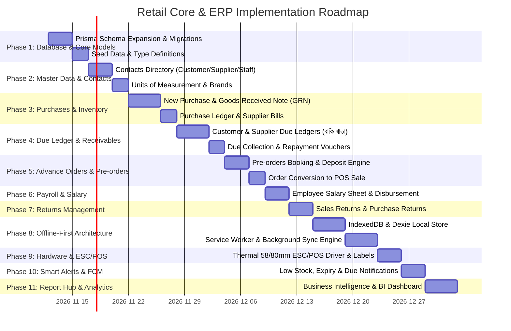

# Implementation Plan — Retail Core & ERP Production Deployment

**Target Specification:** `modules.txt` Modular Architecture  
**System Reference:** `SYSTEM_DOCUMENTATION.md` (Version 3.0)  
**Base Application:** `shop/` (Next.js 16, React 19, Prisma, Neon Serverless PostgreSQL)  
**Execution Horizon:** 6 Sprints / 11 Phases  

---

## 1. Executive Summary & Gap Analysis

A rigorous audit of the existing codebase (`shop/src`, `shop/prisma`) against the target architecture in `modules.txt` reveals the following current state and implementation gaps:

| Functional Area (`modules.txt`) | Current Implementation Status | Gap & Required Implementation | Priority |
| :--- | :--- | :--- | :---: |
| **01.1 নতুন বিক্রয় (POS Terminal)** | Partially Implemented | Exists in `shop/src/components/pos/PosTerminal.tsx`. Needs barcode shortcut keys (`F2`), customer due sale selection, and offline queue support. | High |
| **01.2 নতুন ক্রয় (Purchases & GRN)** | Missing | No `Purchase` or `PurchaseItem` models. Only manual stock adjustment exists. Need complete inward GRN, bill entry, supplier selection, and WAC cost calculation. | Critical |
| **01.3 অর্ডার তৈরি (Advance Orders)** | Missing | No pre-order or quotation engine. Need advance order booking, delivery date scheduler, advance deposit collection, and one-click sale conversion. | High |
| **01.4 নতুন খরচ (New Expense)** | Implemented | Fully functional via `shop/src/actions/finance.ts` and `FinanceManager.tsx` with category selection and user attribution. | Done |
| **02.1 বিক্রয় খাতা (Sales Ledger)** | Implemented | Fully functional in `SalesManager.tsx` with date filters, thermal reprint, voiding, and CSV export. | Done |
| **02.2 বাকি খাতা (Due Ledger)** | Missing | Customer and supplier dues are not formally tracked in ledgers. Need dedicated Due Ledger with aging, customer credit limit, and repayment modals. | Critical |
| **02.3 ক্রয় খাতা (Purchase Ledger)** | Missing | Needs purchase bill register, supplier history, and inward stock verification. | High |
| **02.4 স্টক সমন্বয় (Stock Adjustment)** | Partially Implemented | Basic stock adjustments exist in `inventory.ts`. Needs reason codes (wastage, damage, audit variance) and batch/expiry tracking. | Medium |
| **03.1 পণ্যসমূহ (Products & Barcodes)** | Implemented | Complete CRUD in `products.ts` and `ProductsManager.tsx`. Needs barcode sticker printing and expiry days configuration. | Medium |
| **03.2 ক্যাটাগরি ও ব্র্যান্ড (Categories & Brands)**| Partially Implemented | Categories implemented. `Brand` model and brand-wise filtering are missing. | Medium |
| **03.3 ইউনিট (Units - UOM)** | Partially Implemented | Units are hardcoded strings (`unit = "pcs"`). Need formal `Unit` model with fractional conversion rates (kg $\leftrightarrow$ gm, liter $\leftrightarrow$ ml). | High |
| **03.4 কন্টাক্টস (Customer, Supplier, Staff)**| Partially Implemented | Only `User` exists for login. Need unified `Contact` model for Customers, Suppliers, and Staff with due balances and salary profiles. | Critical |
| **03.5 লাইভ অ্যাপ প্রিভিউ (Catalog)** | Implemented | Exists in `PublicShowcaseClient.tsx`. | Done |
| **04.1 ক্যাশবক্স ও দৈনিক রিকনসিলিয়েশন** | Implemented | Daily sessions, opening float, variance checking, and cutoff locks exist in `treasury.ts`. | Done |
| **04.2 ব্যাংক হিসাব ও লেনদেন** | Implemented | Multi-account ledgers, MFS wallets, and atomic inter-account transfers exist in `treasury.ts`. | Done |
| **04.3 বর্তমান স্টক (Live Stock)** | Implemented | Live stock and valuation exist in `InventoryManager.tsx`. Needs low-stock badges and reorder suggestions. | Low |
| **04.4 কর্মচারী বেতন (Payroll)** | Missing | No payroll calculation or disbursement. Need monthly salary generation, deductions, bonuses, and disbursement ledger entries. | High |
| **05.1–05.6 ব্যবসায়িক রিপোর্ট (Report Hub)** | Partially Implemented | Date & Month P&L exists in `reports.ts`. Missing staff-wise sales, itemized profit ranking, purchase register, and stock IN/OUT ledger. | High |
| **06.1 দোকান ও অ্যাপ সেটিংস** | Implemented | Store profile, address, BIN/VAT, and receipt footer exist in `ShopProfileSection.tsx`. | Done |
| **06.2 প্রিন্টার সেটআপ (Thermal & Label)** | Partially Implemented | Standard browser print exists. Needs direct ESC/POS byte generator (WebUSB/Bluetooth/Network) and label printer setup. | High |
| **06.3 দোকান অ্যাক্সেস ও ইউজার অনুমতি** | Implemented | Multi-role RBAC (Owner, Admin, Manager, Cashier, Staff) exists in `users.ts` and `UserManagerSection.tsx`. | Done |
| **Pillar 02: অফলাইন-প্রথম (Offline-First)** | Missing | System relies on active internet. Needs IndexedDB local catalog, offline sales outbox, Service Worker, and bi-directional sync engine. | Critical |
| **Pillar 03: স্মার্ট সতর্কতা (Smart Alerts)**| Missing | Need real-time notification engine for low stock, expiring perishables, overdue dues via local toasts, and FCM push. | High |

---

## 2. Phase-by-Phase Technical Implementation Roadmap

---

## 3. Detailed Work Breakdown by Phase

### Phase 1: Database Schema Expansion & Migration
- **Files Modified/Created:**
  - `shop/prisma/schema.prisma`
  - `shop/prisma/seed.ts`
  - `shop/prisma/migrations/`
- **Deliverables:**
  1. Add `Contact` (`CUSTOMER`, `SUPPLIER`, `EMPLOYEE`), `ContactLedger`, `Brand`, `Unit` models.
  2. Add `Purchase` and `PurchaseItem` models with supplier foreign key and tax/discount fields.
  3. Add `Order` and `OrderItem` models for advance booking.
  4. Add `SalesReturn`, `SalesReturnItem`, and `PurchaseReturn` models.
  5. Add `PayrollRecord` model for monthly salary calculations.
  6. Add `PrinterSetting` model for hardware configuration.
  7. Run `npx prisma migrate dev --name expand_production_modules` and update `seed.ts` with test customers, suppliers, and units.

### Phase 2: Master Data & Contacts Infrastructure (Module 03)
- **Files Modified/Created:**
  - `shop/src/actions/contacts.ts`
  - `shop/src/actions/products.ts`
  - `shop/src/app/(admin)/contacts/page.tsx`
  - `shop/src/components/contacts/ContactDirectory.tsx`
  - `shop/src/components/contacts/ContactModal.tsx`
  - `shop/src/components/settings/UnitSettingsSection.tsx`
  - `shop/src/components/settings/BrandSettingsSection.tsx`
- **Deliverables:**
  1. Unified Contacts management interface with tabbed views: Customers, Suppliers, Staff.
  2. Customer credit limit validation and opening balance tracking.
  3. Units of Measurement (UOM) management with fractional decimal rates.
  4. Brand catalog setup and association with products.

### Phase 3: Purchases & Inward Goods (Module 01 & 02) — [COMPLETED & VERIFIED]
- **Files Modified/Created:**
  - `shop/src/actions/purchases.ts`
  - `shop/src/app/(admin)/purchases/page.tsx`
  - `shop/src/components/purchases/NewPurchaseModal.tsx`
  - `shop/src/components/purchases/PurchaseManager.tsx`
  - `shop/src/components/purchases/PurchaseBillModal.tsx`
  - `shop/scripts/test-purchases.ts`
- **Deliverables:**
  1. Inward Goods Received Note (GRN) entry form supporting supplier selection, bill number, item line entries, and WAC recalculation.
  2. Dynamic Weighted-Average Cost (WAC) update logic during stock receiving.
  3. Direct payment posting from chosen account (Cash/Bank) or posting to Supplier Due Ledger for credit purchases.
  4. Historical Purchase Ledger with bill printing, filters, and pagination.

### Phase 4: Due Ledger & Credit Management (Module 02: বাকি খাতা) — [COMPLETED & VERIFIED]
- **Files Modified/Created:**
  - `shop/src/actions/dues.ts`
  - `shop/src/app/(admin)/dues/page.tsx`
  - `shop/src/components/dues/DueLedgerManager.tsx`
  - `shop/src/components/dues/CustomerDueCollectionModal.tsx`
  - `shop/src/components/dues/SupplierDuePaymentModal.tsx`
  - `shop/src/components/dues/DueRepaymentReceiptModal.tsx`
  - `shop/scripts/test-dues.ts`
- **Deliverables:**
  1. Centralized **বাকি খাতা** (Due Ledger) route showing Customer Receivables and Supplier Payables.
  2. ContactLedger tracking for all credit transactions.
  3. Customer Due Collection workflow: Records partial/full repayment, issues repayment money receipt, credits the selected cash/bank account, and updates customer balance.
  4. Supplier Due Disbursement workflow: Records vendor payment, debits cash/bank account, and logs audit trail.

### Phase 5: Advance Orders & Pre-orders (Module 01: অর্ডার তৈরি) — [COMPLETED & VERIFIED]
- **Files Modified/Created:**
  - `shop/src/actions/orders.ts`
  - `shop/src/app/(admin)/orders/page.tsx`
  - `shop/src/components/orders/OrderManager.tsx`
  - `shop/src/components/orders/NewOrderModal.tsx`
  - `shop/src/components/orders/OrderDetailModal.tsx`
  - `shop/src/components/orders/OrderDeliveryModal.tsx`
  - `shop/src/components/orders/OrderChallanSlipModal.tsx`
  - `shop/scripts/test-orders.ts`
- **Deliverables:**
  1. Advance booking modal with delivery date, customer contact, itemized sweet orders, and packaging notes.
  2. Advance deposit collection: Posts initial token money to Cash/Bank account.
  3. Order status progression (`PENDING` $\rightarrow$ `CONFIRMED` $\rightarrow$ `IN_PREPARATION` $\rightarrow$ `READY` $\rightarrow$ `DELIVERED` / `CANCELLED`).
  4. One-click `convertOrderToSaleAction`: Transfers order items to confirmed retail sale invoice, settles remaining balance, decrements retail stock, records `StockMovement`, and prints delivery challan/slip.

### Phase 6: Payroll & Employee Salary (Module 04: কর্মচারী বেতন) — [COMPLETED & VERIFIED]
- **Files Modified/Created:**
  - `shop/src/actions/payroll.ts`
  - `shop/src/app/(admin)/payroll/page.tsx`
  - `shop/src/components/payroll/PayrollManager.tsx`
  - `shop/src/components/payroll/SalaryAdjustmentModal.tsx`
  - `shop/src/components/payroll/DisburseSalaryModal.tsx`
  - `shop/src/components/payroll/BatchDisburseModal.tsx`
  - `shop/src/components/payroll/PayslipModal.tsx`
  - `shop/scripts/test-payroll.ts`
- **Deliverables:**
  1. Monthly payroll sheet generator: Computes base salaries, bonus additions, and advance/absence deductions for all active staff.
  2. Single-click batch or individual salary disbursement from Cash Drawer or Bank Account.
  3. Automatic creation of `Transaction(EXPENSE, PAYROLL)`, `ContactLedger` audit entries, and printable thermal/A4 payslips.

### Phase 7: Returns Management (Module 01, 02 & 05: বিক্রয় ফেরত ও ক্রয় ফেরত) — [COMPLETED & VERIFIED]
- **Files Modified/Created:**
  - `shop/src/actions/returns.ts`
  - `shop/src/app/(admin)/returns/page.tsx`
  - `shop/src/components/returns/ReturnsManager.tsx`
  - `shop/src/components/returns/NewSalesReturnModal.tsx`
  - `shop/src/components/returns/NewPurchaseReturnModal.tsx`
  - `shop/src/components/returns/ReturnSlipModal.tsx`
  - `shop/scripts/test-returns.ts`
- **Deliverables:**
  1. Sales Return workflow: Search original invoice, select returned item and quantity, designate restock vs wastage write-off, refund cash or credit customer due balance, and post `StockMovement(SALE_RETURN)`.
  2. Purchase Return workflow: Issue debit note to supplier, adjust vendor payable balance, and record `ContactLedger` audit entry.
  3. Returns manager view with printable thermal return slip.

### Phase 8: Offline-First Architecture & Sync Engine (Core Highlight 02) — [SPECIFIED FOR MOBILE APP POS]
> [!NOTE] Architectural Decision per User Specification
> As confirmed by system requirements, the offline-first sync engine (IndexedDB local replica and background queue sync) is designated exclusively for the Flutter/React Native **Mobile App POS**.
> The Web Application (`shop/`) operates directly with Neon Serverless PostgreSQL with cold-start retry tolerance (`withDbRetry`), interactive transaction timeout safeguards (`TX_OPTIONS`), and client idempotency tokens (`idempotencyKey`) on POS sales.

### Phase 9: Hardware & Thermal Printer Engine (Module 06 & Core Highlight 01) — [COMPLETED & VERIFIED]
- **Files Modified/Created:**
  - `shop/src/lib/escpos.ts` (Binary ESC/POS builder with 58mm/80mm widths, text alignments, double sizing, cash drawer kick `ESC p 0 25 250`, paper feed and cut `GS V`)
  - `shop/src/lib/barcode.ts` (Pure TypeScript Code128 barcode encoder & SVG generator)
  - `shop/src/actions/printers.ts` (Printer settings CRUD server actions)
  - `shop/src/components/settings/PrinterSettingsSection.tsx` (ESC/POS thermal printer setup wired into `/settings`)
  - `shop/src/components/products/BarcodeStickerModal.tsx` (Sticker generator modal with dimensions 38x25mm and 50x25mm wired into Products table)
  - `shop/scripts/test-printers-alerts.ts` (Verified ESC/POS byte sequence generation, Code128 barcode rendering, and printer persistence)
- **Deliverables:**
  1. Direct ESC/POS binary command encoder supporting WebUSB, WebBluetooth, and TCP Network thermal printers (58mm & 80mm).
  2. Automatic cash drawer kick pulse (`ESC p 0 25 250`) and paper cut command (`GS V`).
  3. Barcode sticker label generator with configurable dimensions (38x25mm, 50x25mm) for retail shelf and packaging labels.
  4. Test print receipt byte stream preview and download in Settings.

### Phase 10: Smart Alerts & Notifications Engine (Core Highlight 03) — [COMPLETED & VERIFIED]
- **Files Modified/Created:**
  - `shop/src/actions/alerts.ts` (`getSmartAlerts` server action evaluating low stock, perishables, and overdue dues)
  - `shop/src/components/shared/SmartAlertsPopover.tsx` (Header Notification Center with badge counter, 60s live poll, and categorized alerts)
  - `shop/src/components/shared/AppShell.tsx` & `shop/src/components/shared/PosShell.tsx` (Wired Popover into both desktop AppShell and POS header)
  - `shop/scripts/test-printers-alerts.ts` (Verified alert queries and aggregation)
- **Deliverables:**
  1. In-app notification center popover aggregating critical store alerts:
     - Low Stock Alert when `stockQty <= 10` or reorder level.
     - Zero Stock Alert for sold-out items.
     - Perishable Alert for items nearing expiry.
     - Overdue Credit Reminder when customer due balance exceeds credit limit or ৳5,000 threshold.
  2. Live badge indicator with animated pulse for unacknowledged warnings.

### Phase 11: Business Intelligence & Report Hub (Module 05 & Core Highlight 04) — [COMPLETED & VERIFIED]
- **Files Modified/Created:**
  - `shop/src/actions/reports.ts` (`getStaffPerformanceReportAction`, `getStockMovementLedgerAction`, `getSupplierPurchaseRegisterAction`)
  - `shop/src/components/reports/DateMonthReportsView.tsx` (Added Tab 7: কর্মীভিত্তিক পারফরম্যান্স, Tab 8: Live Stock IN/OUT লেজার, Tab 9: সাপ্লাইয়ার ক্রয় ও চালান রেজিস্টার)
  - `shop/scripts/test-reports.ts` (Verified all 3 BI queries and data aggregation)
- **Deliverables:**
  1. Staff/Cashier performance leaderboard: Tracks gross sales, invoice count, and average transaction value.
  2. Live Stock Movement Ledger: Comprehensive chronological audit card tracing purchases, sales, adjustments, and returns with quantity delta and balance after.
  3. Supplier Purchase Register: Aggregated supplier purchase volume, total paid, and outstanding payables.
  4. Production build tested and verified via `npm run build` and `npm run typecheck`.

---

## 4. Verification, Testing & Quality Gates

| Phase | Test Strategy & Validation Criteria | Target Metric |
| :--- | :--- | :--- |
| **Data Integrity** | Prisma foreign key constraints, unique constraints on invoice/bill numbers, signed stock balances. | Zero orphaned records |
| **Financial Ledger** | Transfer transactions balance to zero. Closing cash balance matches counted cash + adjustment. | $\sum \text{Debits} == \sum \text{Credits}$ |
| **POS Performance** | Under-load checkout performance testing with Turbopack. | $\le 800\text{ms}$ checkout latency |
| **Offline Resilience** | Disconnect network in DevTools $\rightarrow$ execute 10 POS sales $\rightarrow$ reconnect $\rightarrow$ verify batch commit in Neon. | 100% sync, 0 duplicate invoices |
| **Printer Fidelity** | Physical test on 58mm & 80mm ESC/POS thermal printers via WebUSB and Bluetooth. | Clean Bengali glyphs & aligned columns |
| **Localization** | 100% string coverage across English and Bengali dictionaries in `src/lib/i18n.ts`. | Zero raw untranslated strings |
