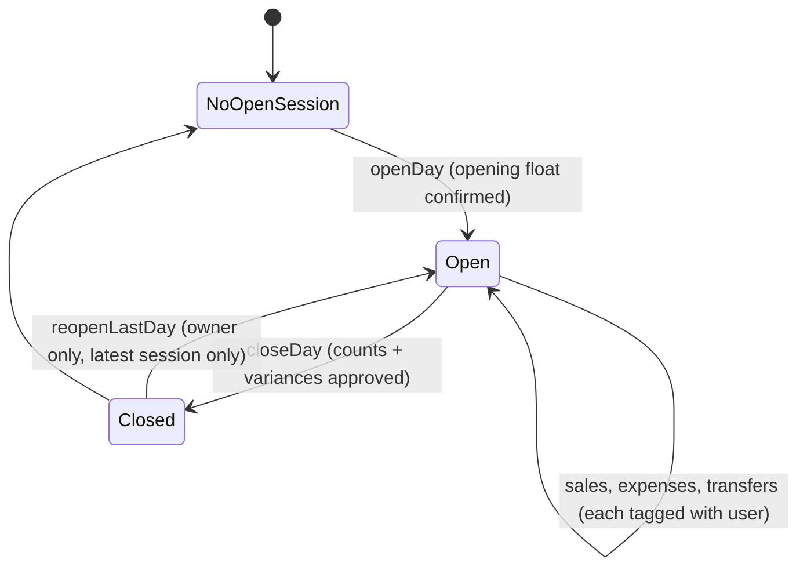

# Implementation Plan — Account Balances, Day Open/Close and Reconciliation

**Project:** Shop Management System (Next.js, Neon, Prisma)  
**Date:** 7 November 2026 (Updated with User Attribution & Review Enhancements)  
**Baseline code:** Active repository (`shop/`). Phase 0 verifies every assumption against code before building.

---

## 1. Goal

Give the shop owner a trustworthy daily money routine:

1. Each account (cash drawer, safe, banks, bKash/Nagad) has its own running balance.
2. The owner opens the day by confirming the opening cash float. Bank and mobile accounts carry forward.
3. Every payment, expense, supplier payment, and transfer hits the account actually used.
4. Moving money between accounts is a **transfer**, never income or expense.
5. At close, the system shows the expected balance per account. The owner enters the counted/statement balance; any shortage or surplus requires a reason and an authorized approver.
6. Confirming saves a locked closing statement. The closing balances become the next opening balances.
7. A lifetime statement per account stays available separately, and a daily dashboard shows current balances and today's reconciliation status.
8. **User attribution:** Every transaction, statement row, and closing audit entry explicitly identifies **which user created or authorized it** (name and role).

### Out of scope for this plan

- Multiple cashier shifts per day (one session per day for now)
- Branches
- Bank statement import or automatic matching
- Tax/VAT handling

---

## 2. Design decisions

| # | Decision | Why |
|---|---|---|
| D1 | **Transfers are two ledger rows** with `source = TRANSFER` and a shared `transferId` (out of one account, into another). | Every existing balance query stays correct with no change. Profit ignores them because it only counts `SALE` and `MANUAL`. |
| D2 | **Money entering or leaving the business outside sales and expenses goes through an `OWNER` account** (owner drawings, capital added, float differences). | Prevents owner takings from being booked as expenses and distorting profit. |
| D3 | **A "books closed through" cutoff** (`Organization.booksClosedThrough`) is set on every confirmed close. No posting may be dated at or before it. | One guard function protects every write path. |
| D4 | **Voiding after close posts a `REFUND` transaction dated now.** It never modifies closed-day rows or flips past sales to `VOID`. | Historical statements remain frozen and profit is not penalized twice. |
| D5 | **Variances are posted as ledger rows** (`source = CLOSING_ADJUSTMENT`, category "Cash difference") when the close is confirmed. | After a close, every account's ledger balance equals the counted balance, so carry-forward is automatic. |
| D6 | **Sessions follow open/close times, not calendar dates.** Only one session may be open at a time. | A shop can trade past midnight. |
| D7 | **Approval uses existing roles plus password re-entry.** No new PIN. | Less to store and secure; uses bcrypt validation. |
| D8 | **Pre-opening sales are attributed to the upcoming session.** | A forgotten opening must not stop sales. The opening float remains the base float from the safe/drawer; early sales flow into today's `salesIn`. |
| D9 | **bKash/Nagad fees are a separate manual expense** on that wallet ("Payment gateway fees"). The sale stays at its gross amount. | Sales totals stay true. |
| D10 | **POS payment methods are active real accounts of type `CASH`, `BANK`, or `MOBILE`** (excluding `SAFE` and `OWNER`). | Replaces hardcoded name guessing while preventing customers from paying into Safe or Owner Equity. |
| D11 | **User attribution across all ledger & closing records.** Every transaction stores `createdById` with a Prisma relation to `User`. Statements, audits, and closing summaries display the user's name and role. | Uncompromising accountability for cashier receipts, manager expenses, and owner transfers. |

### Session lifecycle



---

## 3. Invariants (must always hold; each has a test)

1. **Transfer neutrality:** The two rows of a transfer sum to zero, and a transfer never changes profit.
2. **Close equals ledger:** After a confirmed close, each account's ledger balance equals its counted balance.
3. **Opening equals last close:** The opening balance of a session equals the previous session's counted balance (or current ledger for first-ever session).
4. **Closed days are immutable:** Nothing can be posted, edited, or voided at or before `booksClosedThrough`.
5. **One open session** per organization at any time (enforced by a database partial unique index).
6. **Variance is explained:** A non-zero variance cannot be confirmed without a reason and an authorized approver with valid password verification.
7. **Explicit user attribution:** Every transaction, transfer, opening, closing, and reopen action must link to the user who executed it.
8. **Reopen rollback safety:** Reopening the latest closed day restores `booksClosedThrough` to the previous session, voids closing adjustments, and logs an owner audit entry.

---

## 4. Data model changes (Prisma)

```prisma
enum TxSource    { SALE PURCHASE MANUAL TRANSFER CLOSING_ADJUSTMENT REFUND }
enum AccountType { CASH MOBILE BANK SAFE OWNER }
enum SessionStatus { OPEN CLOSED }

model Transaction {
  // Existing fields remain: id, organizationId, type, source, amount, accountId, categoryId, saleId, description, occurredAt, createdById, voidedAt, createdAt
  transferId  String?
  createdBy   User?         @relation(fields: [createdById], references: [id])
  
  @@index([organizationId, transferId])
  @@index([organizationId, accountId, occurredAt, id])
  @@index([organizationId, createdById])
}

model Organization {
  booksClosedThrough DateTime?
  daySessions        DaySession[]
  auditLogs          AuditLog[]
}

model User {
  // Add reverse relations:
  transactions      Transaction[]
  sessionsOpened    DaySession[]  @relation("SessionOpenedBy")
  sessionsClosed    DaySession[]  @relation("SessionClosedBy")
  sessionsApproved  DaySession[]  @relation("SessionApprovedBy")
  auditLogs         AuditLog[]
}

model DaySession {
  id             String              @id @default(uuid())
  organizationId String
  businessDate   DateTime            @db.Date      // Dhaka date when opened, for display only
  status         SessionStatus       @default(OPEN)
  openedAt       DateTime            @default(now())
  openedById     String
  openedBy       User                @relation("SessionOpenedBy", fields: [openedById], references: [id])
  closedAt       DateTime?
  closedById     String?
  closedBy       User?               @relation("SessionClosedBy", fields: [closedById], references: [id])
  approvedById   String?
  approvedBy     User?               @relation("SessionApprovedBy", fields: [approvedById], references: [id])
  note           String?
  closings       DayAccountClosing[]
  organization   Organization        @relation(fields: [organizationId], references: [id])

  @@index([organizationId, openedAt])
  @@index([organizationId, status])
}

model DayAccountClosing {
  id              String      @id @default(uuid())
  sessionId       String
  accountId       String
  openingBalance  Decimal     @db.Decimal(14, 2)
  salesIn         Decimal     @db.Decimal(14, 2)
  otherIn         Decimal     @db.Decimal(14, 2)
  expensesOut     Decimal     @db.Decimal(14, 2)
  purchasesOut    Decimal     @db.Decimal(14, 2)
  transfersNet    Decimal     @db.Decimal(14, 2)
  expectedBalance Decimal     @db.Decimal(14, 2)
  countedBalance  Decimal     @db.Decimal(14, 2)
  variance        Decimal     @db.Decimal(14, 2)   // counted - expected
  varianceReason  String?
  adjustmentTxId  String?
  session         DaySession  @relation(fields: [sessionId], references: [id])
  account         Account     @relation(fields: [accountId], references: [id])

  @@unique([sessionId, accountId])
}

model AuditLog {
  id             String        @id @default(uuid())
  organizationId String
  userId         String
  user           User          @relation(fields: [userId], references: [id])
  action         String        // OPEN_DAY, CLOSE_DAY, REOPEN_DAY, TRANSFER, VOID_SALE, REFUND, ...
  entity         String
  entityId       String?
  detail         Json?
  createdAt      DateTime      @default(now())
  organization   Organization  @relation(fields: [organizationId], references: [id])

  @@index([organizationId, createdAt])
  @@index([organizationId, userId])
}
```

**Migration SQL extras** (Prisma cannot express partial unique index):

```sql
-- Invariant 5: only one open session per organization
CREATE UNIQUE INDEX "DaySession_one_open_per_org"
  ON "DaySession" ("organizationId") WHERE status = 'OPEN';
```

**Seed additions:**
- Accounts: "Cash Drawer" (`CASH`), "Safe" (`SAFE`), "Owner Capital/Drawings" (`OWNER`).
- Categories: "Cash difference" (both `EXPENSE` and `INCOME` types) and "Payment gateway fees" (`EXPENSE`).

---

## 5. Services (`src/modules/treasury/`)

All treasury functions execute inside `prisma.$transaction(…, TX_OPTIONS)`, validate input with Zod, record `AuditLog` rows, and attribute the acting `userId`.

| File | Functions | Notes |
|---|---|---|
| `guard.ts` | `assertPostingAllowed(tx, orgId, occurredAt)` | Throws if `occurredAt <= booksClosedThrough`. Called by every write path. |
| `balances.ts` | `balancesAsOf(orgId, at?)`, `accountStatement(orgId, accountId, from, to)` | Pre-computes opening balance scalar up to `from`, then queries rows with user name and role. |
| `transfers.ts` | `transferFunds({ fromId, toId, amount, note, userId })` | Different accounts, same org, amount > 0. Uses `FOR UPDATE` row lock on source account to block overdrawing cash/safe. |
| `sessions.ts` | `getCurrentSession`, `openDay({ openingCash, destinationAccountId, userId })`, `reopenLastDay({ userId })` | `openDay` posts a transfer to/from Safe/Owner if float differs from yesterday. `reopenLastDay` resets `booksClosedThrough` and voids closing adjustments. |
| `closing.ts` | `prepareClosing(orgId)`, `closeDay({ counted, fingerprint, approverId, approverPassword, userId })` | Computes expected balances per account; verifies optimistic fingerprint; verifies bcrypt password for variances; posts adjustments and closes session. |

### 5.1 Write paths wired to the guard

Every write path passes through `assertPostingAllowed`:
- `addManualTransaction`, `voidTransaction`
- `recordSalePayment`
- `receiveStock` (when paid immediately with `accountId`; remains optional for unpaid vendor credit)
- `voidSale` (reversal refund if post-cutoff)
- `transferFunds`
- `createSale`

### 5.2 Closing algorithm & Pre-Opening Sales

`prepareClosing(orgId)` returns per account:
- `opening`: Previous counted balance (or current ledger for session 1).
- Transaction totals for the session: `salesIn`, `otherIn`, `expensesOut`, `purchasesOut`, `transfersNet`.
- Transactions considered: All active rows between `previousSession.closedAt` (or start of day) and now.
- `fingerprint`: Count and latest `createdAt` of transactions in scope.
- User breakdown: Inflow/outflow subtotals grouped by cashier/user.

`closeDay(...)` in one transaction:
1. Re-runs `prepareClosing` and verifies fingerprint matches.
2. Checks variances (`counted - expected`). If any variance ≠ 0:
   - Validates required reason per variance.
   - Validates approver role (OWNER or ADMIN) and verifies password with `bcrypt.compare`.
3. Posts `CLOSING_ADJUSTMENT` transactions (category "Cash difference") created by `userId`.
4. Saves `DayAccountClosing` records, marks `DaySession` as `CLOSED`, updates `Organization.booksClosedThrough = closedAt`.
5. Writes `AuditLog` entry.

### 5.3 Post-Close Voiding & Refunds

If a sale's payment row was posted at or before `booksClosedThrough`:
- Do **NOT** mutate the original sale to `VOID` or flip its `voidedAt`.
- Create a `REFUND` transaction (`type = EXPENSE, source = REFUND`) dated now, linked to the sale, deducting from the refund account.
- Create inventory return movement (`SALE_VOID`) dated now.
- Preserves historical locked reports without double-hitting profit.

---

## 6. Server actions, permissions & Route guards

1. **Route Guard Update in `proxy.ts`:**
   Add `/finance/daily` or allow `MANAGER` access to `/finance` sub-actions:
   ```typescript
   const managerAllowedPrefixes = ["/pos", "/products", "/inventory", "/finance"];
   ```
2. **Server Actions (wrapped with `handleAction`, `requireRole`, and user session pass-through):**

| Action | Roles | User Attribution |
|---|---|---|
| `getTreasuryOverviewAction` | OWNER, ADMIN, MANAGER | Logged in user |
| `openDayAction` | OWNER, ADMIN, MANAGER | Recorded as `openedById` |
| `transferFundsAction` | OWNER, ADMIN, MANAGER | Recorded as `createdById` |
| `prepareClosingAction` | OWNER, ADMIN, MANAGER | Returns session totals |
| `closeDayAction` | OWNER, ADMIN, MANAGER (variance approval: OWNER or ADMIN) | Recorded as `closedById` & `approvedById` |
| `reopenLastDayAction` | OWNER only | Recorded in `AuditLog` with `userId` |
| `getAccountStatementAction` | OWNER, ADMIN, MANAGER | Includes `createdBy` (name, role) for every row |
| `getSessionStatusAction` | Any authenticated user | Read-only POS banner |

---

## 7. UI Plan (Mobile-First, Bilingual bn/en)

**Finance Page (`/finance`) Tabs:**
1. **Today's Cash / Treasury:**
   - Day session status badge (Open / Closed / Not Opened) with opened-by user tag.
   - Per-account cards: Current Balance, Opening, Today's In/Out, user breakdowns.
   - Action buttons: "Open Day", "Transfer", "Close Day".
2. **Transactions Tab:**
   - Unified ledger showing Date/Time, Account, Inflow/Outflow, Category, Description, and **"Created By" (User Name & Role)**.
3. **Account Statement Tab:**
   - Filter by Account and Date Range.
   - Running balance table with Opening Balance, Transaction Details, User Name, and CSV Export.
4. **Open-Day Sheet:**
   - Prefilled with yesterday's closing cash.
   - Difference transfer selector (Move excess to Safe/Owner).
   - Display carried bank/mobile balances.
5. **Closing Wizard (5-Step Sheet):**
   - Step 1: Expected balances & cashier breakdown.
   - Step 2: Denomination calculator for cash count.
   - Step 3: Bank & mobile statements count.
   - Step 4: Variance explanation & approver password prompt.
   - Step 5: Summary lock, printable daily reconciliation sheet with operator & approver signatures.
6. **POS Terminal Integration:**
   - Non-blocking banner: *"Day not opened — Open Day"*.
   - Payment method selector queries active accounts of type `CASH`, `BANK`, `MOBILE` (excludes `SAFE` and `OWNER`).
   - Receipts display real account name and the cashier's name.

---

## 8. Delivery Phases & Step-by-Step Execution

| Phase | Description | Deliverables |
|---|---|---|
| **Phase 0: Verification & Baseline Check** | Audit existing queries, verify Prisma relations, confirm `Transaction.createdById` usage. | Baseline verification checklist. |
| **Phase 1: Database Schema & Migration** | Add enums (`TRANSFER`, `CLOSING_ADJUSTMENT`, `REFUND`, `SAFE`, `OWNER`), `DaySession`, `DayAccountClosing`, `AuditLog`, `transferId`, user relations, and partial unique index. | Prisma client generated & migration applied. |
| **Phase 2: Core Treasury Services** | Implement `guard.ts`, `balances.ts`, `transfers.ts`, `sessions.ts`, `closing.ts` with user attribution and row-level locks. Wire guard to write paths. | Tested service layer in `src/modules/treasury/`. |
| **Phase 3: Integration Tests** | Create automated test suite verifying transfer neutrality, variance authorization, cutoff guard, user tracking, and idempotency. | Automated test runner and passing assertions. |
| **Phase 4: Server Actions & Permissions** | Expose server actions in `actions/finance.ts` and `actions/treasury.ts`, update `proxy.ts` for Manager permissions. | Fully guarded server actions with audit logs. |
| **Phase 5: UI & Bilingual Components** | Build Today's Cash view, Open/Close sheets, Transfer modal, Statement table with User column, and POS account selectors. | Responsive desktop & mobile views. |
| **Phase 6: Hardening & Documentation** | Run smoke test, execute full trading day simulation, verify zero variance reconciliation, update documentation. | Verified release candidate. |

---

## 9. Definition of Done

- [ ] Every transaction and statement row displays the user who created it.
- [ ] Only one day session can be open at a time.
- [ ] Post-cutoff transactions cannot be posted without reversing as today's refund.
- [ ] Variance approval requires OWNER/ADMIN role and valid password verification.
- [ ] POS payment accounts strictly exclude SAFE and OWNER equity accounts.
- [ ] Managers can open/close day and transfer funds without middleware redirect loops.
- [ ] Account statement shows correct running balance with scalar opening balance.
- [ ] All automated tests pass against Neon PostgreSQL.
