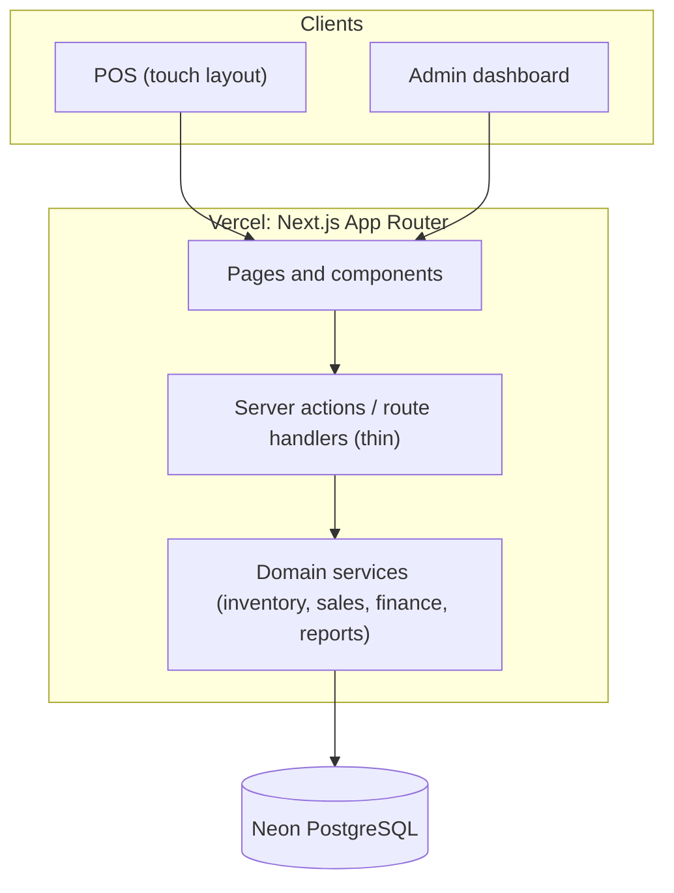
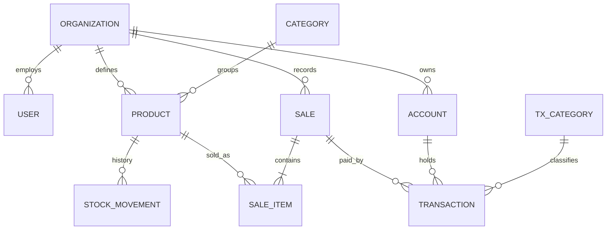

# Retail Shop Management System — Complete Documentation

**Version:** 1.0 (core + UI specification)
**Date:** 3 November 2026
**Stack:** Next.js (TypeScript), Neon PostgreSQL, Prisma, Zod, Tailwind CSS, shadcn/ui, Recharts
**Hosting:** Vercel
**Currency / timezone:** BDT (৳) / Asia/Dhaka

---

## Table of contents

1. [Overview and scope](#1-overview-and-scope)
2. [Architecture](#2-architecture)
3. [Project structure](#3-project-structure)
4. [Setup and deployment](#4-setup-and-deployment)
5. [Data model](#5-data-model)
6. [Business rules and metric definitions](#6-business-rules-and-metric-definitions)
7. [Domain service reference](#7-domain-service-reference)
8. [Concurrency, integrity and security](#8-concurrency-integrity-and-security)
9. [UI/UX design guidelines](#9-uiux-design-guidelines)
10. [Page specifications](#10-page-specifications)
11. [Testing and acceptance criteria](#11-testing-and-acceptance-criteria)
12. [Roadmap](#12-roadmap)
13. [Known limitations and open decisions](#13-known-limitations-and-open-decisions)

---

## 1. Overview and scope

A web application for running a small retail shop. It covers three areas:

| Area | What it does |
|---|---|
| **Stock management** | Products, categories, stock in, adjustments, low-stock alerts, full stock history |
| **Sales and finance** | Sales entry (POS), payments, credit sales, manual income and expenses, account balances |
| **Analytics** | Revenue, cost of goods, gross and operating profit, stock value, receivables, trends |

### 1.1 Key decision: income comes from sales

Income is recorded by entering sales in the system, not typed in by hand. A sale reduces stock, snapshots the product cost, and posts the payment received as income. This makes profit analytics exact. Manual income is still available for things that are not sales (for example, a refund from a supplier).

### 1.2 MVP scope

**Included**

- Products and categories
- Stock in (purchase), adjustments, stock ledger, low-stock list
- Sales with discounts, partial payment (credit sales), later payment collection, voiding
- Accounts (cash, mobile banking, bank) with balances
- Manual income and expense entry with categories
- Dashboard and reports
- Single shop, with `organizationId` on every record so growth is possible

**Deferred**

- Multiple branches and stock transfers
- Supplier ledgers and purchase orders
- Partial sale returns (a full void exists)
- Public product catalog
- Offline POS
- Thermal printer direct integration (browser print and PDF share first)
- Tax/VAT (until the business rule is confirmed)

### 1.3 Current delivery status

| Layer | Status |
|---|---|
| Database schema (Prisma) | Written |
| Domain services (inventory, sales, finance, dashboard) | Written, **not yet run against a database**; run `npm run smoke` to verify |
| Authentication | Planned (Auth.js) |
| UI pages | Specified in this document, not yet built |

---

## 2. Architecture

A **modular monolith**: one Next.js application, with business rules in domain services rather than in React components or route handlers.



### 2.1 Technology choices

| Concern | Choice | Reason |
|---|---|---|
| Framework | Next.js App Router, TypeScript strict | One codebase for UI and server logic |
| Database | Neon PostgreSQL | Managed, serverless, backups |
| ORM | Prisma | Typed access, migrations |
| Validation | Zod | Same schemas validate forms and services |
| Forms | React Hook Form | Performance, easy Zod integration |
| UI | Tailwind CSS + shadcn/ui + Lucide | Consistent, accessible primitives |
| Charts | Recharts | Simple, sufficient |
| Tables | TanStack Table (via shadcn Data Table) | Sorting, filtering, pagination |
| Client state | Zustand (POS cart only) | Cart is the only complex client state |

### 2.2 Serverless rules (Vercel)

- Keep handlers stateless; never rely on local files or in-memory state between requests.
- Keep database transactions short.
- Use the **pooled** Neon URL for the app (`DATABASE_URL`) and the **direct** URL for migrations (`DIRECT_URL`).
- Place the Vercel function region close to the Neon region.
- Run scheduled work with Vercel Cron, never a long-running process.

---

## 3. Project structure

Current deliverable (`shop-management-core.zip`):

```text
shop/
├── prisma/
│   ├── schema.prisma
│   └── seed.ts
├── scripts/
│   └── smoke.ts                  # acceptance checks against a real database
├── src/
│   ├── lib/prisma.ts             # client, Decimal helper, BusinessError
│   └── modules/
│       ├── inventory/service.ts  # applyMovement, receiveStock, adjustStock, lowStockProducts
│       ├── sales/service.ts      # createSale, recordSalePayment, voidSale
│       ├── finance/service.ts    # manual transactions, account balances
│       └── reports/dashboard.ts  # getDashboard
├── .env.example
├── package.json
├── tsconfig.json
└── README.md
```

Planned additions when the UI is built:

```text
src/
├── app/
│   ├── (auth)/login/
│   ├── (admin)/                  # sidebar layout
│   │   ├── dashboard/
│   │   ├── products/
│   │   ├── inventory/
│   │   ├── sales/
│   │   ├── finance/
│   │   ├── reports/
│   │   └── settings/
│   └── (pos)/pos/                # separate POS layout
├── components/
│   ├── ui/                       # shadcn primitives (do not restyle per page)
│   ├── shared/                   # DataTable, PageHeader, StatusBadge, EmptyState, MoneyText, ...
│   ├── dashboard/
│   └── pos/
├── stores/cart.ts                # Zustand
└── hooks/
```

Rule: route handlers and server actions validate input, check permission, call a service, and return. They contain no business logic.

---

## 4. Setup and deployment

### 4.1 Local setup

```bash
npm install
cp .env.example .env          # fill in the two Neon URLs
npx prisma migrate dev --name init
npm run db:seed
npm run smoke                 # runs the acceptance checks
```

### 4.2 Environment variables

| Variable | Purpose |
|---|---|
| `DATABASE_URL` | Neon **pooled** connection string (app runtime) |
| `DIRECT_URL` | Neon **direct** connection string (migrations) |

Add later: `AUTH_SECRET`, `AUTH_URL` (Auth.js).

### 4.3 Scripts

| Script | Action |
|---|---|
| `npm run db:generate` | Generate the Prisma client |
| `npm run db:migrate` | Create/apply a development migration |
| `npm run db:deploy` | Apply migrations in production |
| `npm run db:seed` | Seed organization, accounts, expense categories, owner user, demo product |
| `npm run smoke` | Run the acceptance checks |
| `npm run typecheck` | TypeScript check |

### 4.4 Deploying to Vercel

1. Create a Neon project and copy both connection strings.
2. Create the Vercel project from the repository; add `DATABASE_URL` and `DIRECT_URL` as environment variables (separate values for Preview and Production).
3. Run `npm run db:deploy` as part of the build or a release step.
4. Enable Neon backups/point-in-time restore and test a restore before going live.

### 4.5 Seed data

The seed creates one organization (`My Shop`), three accounts (Cash, bKash, Bank), seven expense categories, an owner user and one demo product. For UI development, add a richer demo seed (`db:seed:demo`) with realistic products, a month of sales and expenses so charts and tables show real-looking data.

---

## 5. Data model

### 5.1 Entity relationships



### 5.2 Tables

| Table | Purpose | Key fields |
|---|---|---|
| `Organization` | Business boundary | name, currency (`BDT`), timezone (`Asia/Dhaka`) |
| `User` | Staff | email (unique), role (`OWNER`/`STAFF`), active |
| `Category` | Product grouping | name (unique per organization) |
| `Product` | Sellable item | sku, barcode, unit, sellingPrice, **avgCost**, **stockQty**, reorderLevel, active |
| `StockMovement` | Permanent stock history | type, **signed** quantityDelta, unitCost, balanceAfter, refType/refId, note |
| `InvoiceSequence` | Sequential invoice numbers | lastNo per organization |
| `Sale` | Invoice header | invoiceNo, subtotal, discount, total, **paid**, status, idempotencyKey |
| `SaleItem` | Invoice lines | quantity, unitPrice, **unitCost snapshot**, lineTotal, productName |
| `Account` | Where money sits | name, type (`CASH`/`MOBILE`/`BANK`) |
| `TxCategory` | Income/expense categories | name, type |
| `Transaction` | Money in/out | type, **source** (`SALE`/`PURCHASE`/`MANUAL`), amount, accountId, saleId, voidedAt |

### 5.3 Conventions

- **Primary keys** are UUIDs.
- **Money** is `Decimal(14,2)`; cost is `Decimal(14,4)`; quantity is `Decimal(14,3)`. Never use floating point.
- **Stock movements use signed deltas** everywhere: positive in, negative out.
- `Product.stockQty` is the fast-read balance; `StockMovement` is the permanent history. Both are updated in the same database transaction.
- **Posted records are not edited or deleted.** Sales are voided (`status = VOID`); transactions are voided (`voidedAt` set); stock is corrected by a new movement.
- Every record carries `organizationId`; every query filters by it.

---

## 6. Business rules and metric definitions

### 6.1 Stock

| Event | Movement type | Stock effect |
|---|---|---|
| Stock received | `PURCHASE` | Increase; recalculates average cost |
| Sale completed | `SALE` | Decrease at current average cost |
| Sale voided | `SALE_VOID` | Increase at the cost the item was sold at |
| Adjustment (damage, loss, count fix) | `ADJUSTMENT` | Increase or decrease; reason required |

- **Negative stock is blocked.** A sale or adjustment that would drop below zero fails with "Insufficient stock".
- **Valuation** is weighted average cost:
  `new avg = (existing qty × avg cost + received qty × unit cost) ÷ (existing qty + received qty)`
  If existing stock is zero or negative, the new unit cost becomes the average.
- Each sale line stores a **cost snapshot**, so past profit does not change when costs change later.

### 6.2 Sales and payments

- A sale has a `total` and a `paid` amount. `due = total − paid`.
- `paid` defaults to the full total. A lower value makes it a **credit sale**.
- At initial checkout (`createSale`), customer tendered cash may exceed the total (POS change-giving); the amount credited towards the invoice `paid` is capped at `total`, while change given is calculated and handed back to the customer. In subsequent installment collections (`recordSalePayment`), the collected amount cannot exceed the remaining due balance. An account must be selected whenever payment is received.
- Later payments are recorded with `recordSalePayment` and increase `paid`.
- A discount cannot exceed the subtotal.
- Invoice numbers are sequential per organization: `INV-000001`.
- A checkout attempt carries an **idempotency key**. Retrying the same key returns the original sale.

### 6.3 Finance

- `Transaction.source` decides how a row is treated:

| Source | Created by | Counted as |
|---|---|---|
| `SALE` | Sales (payments received) | Income (already inside revenue) |
| `PURCHASE` | Stock in when paid now | Cash out for inventory; **not** an operating expense |
| `MANUAL` | Owner/staff entry | Operating income or expense |

- Account balance = income in − expenses out, excluding voided rows.

### 6.4 Dashboard metrics

| Metric | Definition |
|---|---|
| Revenue | Sum of completed sale totals in the range |
| Cost of goods (COGS) | Sum of `quantity × unitCost snapshot` for those sales |
| Gross profit | Revenue − COGS (**not** revenue − purchases) |
| Operating expenses | Manual expenses in the range |
| Operating profit | Gross profit − operating expenses + manual other income |
| Stock value | Sum of `stockQty × avgCost` now |
| Receivables | Sum of `total − paid` over completed sales, now |
| Low stock | Active products where `stockQty ≤ reorderLevel` |

Day boundaries for charts use Asia/Dhaka time.

---

## 7. Domain service reference

All services validate input with Zod and throw `BusinessError` for rule violations (for example "Insufficient stock"). Every function takes `orgId`; the caller must derive it from the authenticated session, never from client input.

### 7.1 Inventory — `src/modules/inventory/service.ts`

| Function | Purpose |
|---|---|
| `applyMovement(tx, input)` | The only way stock changes. Locks the product row (`SELECT … FOR UPDATE`), blocks negative stock, updates average cost for purchases, writes the ledger row. Must run inside `prisma.$transaction`. |
| `receiveStock({ orgId, productId, quantity, unitCost, accountId?, note?, userId? })` | Stock in. With `accountId`, also records the cash out as a `PURCHASE` transaction. Without it, no money is recorded (see limitations). |
| `adjustStock({ orgId, productId, quantityDelta, reason, userId? })` | Damage, loss, count correction. |
| `lowStockProducts(orgId)` | Products at or under reorder level. |

### 7.2 Sales — `src/modules/sales/service.ts`

| Function | Purpose |
|---|---|
| `createSale(input)` | Creates the sale, decrements stock, snapshots cost, assigns the invoice number, posts the payment. All in one transaction. |
| `recordSalePayment({ orgId, saleId, amount, accountId, userId? })` | Collect money on a credit sale. |
| `voidSale({ orgId, saleId, userId? })` | Reverses stock at the sold cost and voids linked income. History is kept. |

`createSale` input:

```ts
{
  orgId: string,
  idempotencyKey: string,            // generate once per checkout attempt
  items: [{ productId, quantity, unitPrice? }],  // unitPrice defaults to selling price
  discount?: number,                 // default 0
  paid?: number,                     // default = total
  accountId?: string,                // required if paid > 0
  customerName?: string,
  userId?: string
}
```

### 7.3 Finance — `src/modules/finance/service.ts`

| Function | Purpose |
|---|---|
| `addManualTransaction(input)` | Rent, salary, utilities, other income. |
| `voidTransaction(orgId, id)` | Voids a manual transaction only. |
| `accountBalances(orgId)` | Balance per account. |

### 7.4 Reports — `src/modules/reports/dashboard.ts`

`getDashboard(orgId, from, to)` returns:

```ts
{
  kpis: { revenue, cogs, grossProfit, operatingExpenses, operatingProfit,
          orders, discounts, stockValue, receivables },
  lowStock: [...],
  salesByDay: [{ day, revenue, orders }],
  topProducts: [{ name, qty, revenue, profit }],
  expensesByCategory: [{ category, amount }]
}
```

Still needed for the UI: a recent-transactions query and paginated list queries (products, sales, transactions, stock movements) with search, filter and sort.

---

## 8. Concurrency, integrity and security

### 8.1 Integrity guarantees

- **No overselling:** each product row is locked while its stock changes; locks are taken in sorted product order to avoid deadlocks.
- **No duplicate sales:** the idempotency key is unique; a concurrent retry receives the original sale.
- **Atomic sales:** stock, sale, items, ledger and payment commit together or not at all.
- **History preserved:** voids and corrections add rows; nothing posted is edited in place.

### 8.2 Security (to implement with authentication)

- Authenticate with Auth.js; hash passwords with a modern algorithm (argon2 or bcrypt).
- Derive `orgId` and `userId` from the session on the server only.
- Roles: `OWNER` can see profit, costs, finance and settings and can void; `STAFF` can use POS and view products and stock. Hide cost and profit from staff in the UI **and** enforce it in the server.
- Validate every input with Zod on the server, even if the form already validated it.
- Log voids and adjustments with the acting user (an audit log table is planned).
- Never expose cost prices or finance data through public endpoints.

---

## 9. UI/UX design guidelines

**Goal:** a polished, production-quality retail management application. It must look like professionally designed commercial ERP/POS software, not a generic AI-generated dashboard. Prioritize usability and operational speed over decoration.

### 9.1 Visual direction

- Clean, functional, modern retail ERP design.
- **Light theme by default.** Dark mode is optional and, if added, must use the same tokens.
- Neutral slate/gray surfaces with a restrained blue primary accent.
- One typeface family: **Inter or Geist Sans**.
- **Lucide** icons only, at consistent sizes.
- Prefer subtle 1px borders over shadows.
- **Avoid:** gradients, glassmorphism, large rounded cards, decorative illustrations, and unnecessary animation.

### 9.2 Design tokens

Define tokens once (CSS variables mapped into Tailwind) and use only tokens in components.

**Color**

| Token | Light value | Use |
|---|---|---|
| `background` | slate-50 | App background |
| `surface` | white | Cards, tables, panels |
| `border` | slate-200 | Dividers, outlines |
| `foreground` | slate-900 | Primary text |
| `muted-foreground` | slate-500 | Secondary text, labels |
| `primary` | blue-600 | Primary actions, active nav, focus ring |
| `primary-foreground` | white | Text on primary |
| `success` | green-600 | Completed, paid, positive change |
| `warning` | amber-600 | Low stock, due, attention |
| `danger` | red-600 | Void, out of stock, destructive actions |

Body text on `surface` must meet WCAG AA contrast (4.5:1).

**Typography**

| Role | Size / weight |
|---|---|
| Page title | 20px / 600 |
| Section title | 16px / 600 |
| Body, table cells | 14px / 400 |
| Labels, helper text | 12–13px / 500 |
| KPI value | 22–24px / 600 (never oversized) |
| POS prices and totals | 16–20px / 600 |

Use tabular numerals (`tabular-nums`) for all money and quantities so columns align.

**Spacing and shape**

- 4px base grid; common steps 8 / 12 / 16 / 24.
- Page padding 24px desktop, 16px mobile.
- Border radius: **6px** for inputs, buttons and cards. One radius, used consistently.
- Shadows: none by default; a single light shadow only for overlays (menus, dialogs, sheets).

**Component sizes**

| Element | Size |
|---|---|
| Input, select, button (admin) | 36px high |
| Compact table row | 40px high |
| POS controls (buttons, qty steppers, product tiles) | **minimum 44px**, checkout button 52–56px |
| Icon in buttons / nav | 16px (20px in nav) |

### 9.3 Formatting rules

- Currency: `৳` prefix, thousand separators (`৳ 12,450.00`), 2 decimals; align right in tables.
- Quantities: show decimals only when the unit allows them (kg, litre).
- Dates and times: Asia/Dhaka, `03 Nov 2026, 14:35`.
- Negative or due amounts use the danger/warning color **and** a label or sign, not color alone.
- One shared `MoneyText`, `QuantityText` and `DateTimeText` component; never format inline.

### 9.4 Layout

**Admin (desktop)**

```text
┌──────────┬───────────────────────────────────────────┐
│ Sidebar  │ Top bar: page title · date range · user    │
│ (collaps │───────────────────────────────────────────│
│  ible)   │ Content area (max-width 1440px)            │
│          │   Page header (title, actions)             │
│          │   Filters row                              │
│          │   Content (cards / table)                  │
└──────────┴───────────────────────────────────────────┘
```

- Sidebar: 240px expanded, 56px collapsed (icons with tooltips); remembers state.
- Sidebar items: Dashboard, Sales, Products, Inventory, Finance, Reports, Settings. The POS opens as its own layout.
- Every page uses the same **PageHeader** (title, optional description, primary action on the right).

**Admin (mobile)**

- Bottom navigation with the four most-used destinations (Dashboard, Sales, Products, Finance) and a "More" drawer for the rest.
- Tables switch to a compact card/list presentation (see 9.7).

**POS layout**

- Separate layout with no admin sidebar: a slim top bar (shop name, cashier, "Back to admin", online status) and a full-height working area.

### 9.5 Reusable components

Build once, use everywhere. Do not create page-specific variants.

| Component | Responsibility |
|---|---|
| `AppShell`, `PosShell` | Layouts |
| `PageHeader` | Title, description, actions |
| `KpiCard` | Label, value, optional change; compact |
| `DataTable` | Search, filters, sort, pagination, row actions, responsive mode |
| `StatusBadge` | Maps status to color and label |
| `MoneyText`, `QuantityText`, `DateTimeText` | Formatting |
| `FormField` | Label, control, help text, error |
| `ConfirmDialog` | Destructive confirmation (void sale, void transaction) |
| `EmptyState`, `ErrorState`, `TableSkeleton`, `CardSkeleton` | State views |
| `Toast` | Success and error feedback |
| `DateRangePicker` | Presets and custom range |

### 9.6 Status badges

| Where | Status | Color |
|---|---|---|
| Sale | Completed | success |
| Sale | Void | neutral/slate with strikethrough amounts |
| Payment | Paid | success |
| Payment | Due (partially paid) | warning |
| Stock | In stock | success |
| Stock | Low stock | warning |
| Stock | Out of stock | danger |
| Transaction | Voided | neutral |

Badges always include text, never color alone.

### 9.7 Data tables

- Compact rows (40px), 14px text, sticky header, right-aligned numbers.
- **Search** (debounced), **filters** (status, category, date range), **sorting** on meaningful columns, **pagination** (25 per page default; 10/25/50).
- Filters, sort and page live in the URL query string so views are shareable and survive refresh.
- Pagination, sorting and filtering happen on the **server** for large tables.
- **Row actions** sit in one consistent place: the last column, a single "⋯" menu (View, Edit, Void…), with the primary action as the row click. Destructive items are last and use `ConfirmDialog`.
- **Mobile:** each row becomes a compact card showing the 2–3 most important fields plus the status badge and a "⋯" menu. Horizontal scrolling is a last resort.
- Selection and bulk actions only where they exist and work.

### 9.8 Forms

- Labels above fields, always visible (no placeholder-only labels).
- Validation messages appear under the field, in plain words, after blur or submit: "Enter a selling price" instead of "Invalid input".
- Group related fields under short section titles; use a two-column grid on desktop and one column on mobile.
- Keep forms short: show only fields needed to complete the task; put advanced fields behind an "Additional details" section.
- Inputs share one height (36px; 44px in POS).
- Primary action bottom-right (desktop) and full-width (mobile); show a pending state and disable while saving.
- Reuse the Zod schema from the service for client validation.

### 9.9 Required states

Every page and component that loads data must implement all four:

| State | Requirement |
|---|---|
| **Loading** | Skeletons matching the final layout (no blank screens, no layout jump) |
| **Empty** | Plain explanation and the next action ("No products yet. Add your first product.") |
| **Error** | What failed and a Retry button |
| **Success** | Toast confirming the specific action ("Sale INV-000123 completed") |

### 9.10 Motion

- No decorative animation. Allowed: short (150ms) transitions for menus, dialogs, sheets and sidebar collapse.
- Respect `prefers-reduced-motion`.

### 9.11 Accessibility

- Full keyboard navigation; visible focus ring (2px primary) on every interactive element.
- Semantic HTML; labels bound to inputs; dialogs trap focus and return it on close.
- Icon-only buttons have `aria-label`s and tooltips.
- Toasts and form errors are announced (`aria-live`).
- Contrast meets WCAG AA; information is never conveyed by color alone.
- POS touch targets are at least 44×44px with adequate spacing.

### 9.12 Quality rules

- **Every visible button and interactive element must work.** Do not ship placeholder buttons, dead links or fake menu items. If a feature is not built, do not render its control.
- **Reuse shared components and tokens.** No per-module visual style.
- **Before implementing a page, inspect existing components and follow the established design system.** Add to the shared components when something is missing instead of styling locally.
- Use **realistic sample data** during development (real-looking product names, prices in BDT, a month of sales), never "Lorem ipsum" or "Product 1".
- Maintain consistent page layouts: same header, filter row position, spacing and table placement on every list page.

### 9.13 Definition of done for a page

- [ ] Uses `PageHeader`, shared components and tokens only
- [ ] Loading, empty, error and success states implemented
- [ ] All buttons, links, filters and row actions work
- [ ] Keyboard-navigable; focus visible; labels present
- [ ] Works at 360px, 768px and 1280px widths
- [ ] Money, dates and quantities use the shared formatters
- [ ] Server validates all input; permission check in place
- [ ] Tested with realistic data

---

## 10. Page specifications

### 10.1 Dashboard (`/dashboard`)

**Filters:** date range (Today, Last 7 days, Last 30 days, This month, Custom). A branch filter is part of the layout slot but hidden while the system runs as a single shop; it appears when branches are added.

**Layout**

1. **KPI row** (compact cards): Revenue, Gross profit, Operating expenses, Operating profit, Stock value, Receivables. Order count and discounts appear as secondary text where useful.
2. **Sales chart:** revenue by day as a simple line or bar chart with labeled axes, ৳ units and a tooltip showing revenue and order count. No gradient fill.
3. **Two-column row:** *Top products* (horizontal bars, with revenue and profit) and *Expenses by category* (horizontal bars).
4. **Bottom row:** *Recent transactions* table (last 10: time, description, account, type, amount) and *Low-stock alerts* list (product, remaining, reorder level, "Restock" action that opens stock-in).

KPI values stay at 22–24px. Cards use border and no shadow. Staff role sees no profit or cost figures.

### 10.2 POS (`/pos`)

Touch-first, separate layout.

**Tablet/desktop:** two panes.

```text
┌───────────────────────────────┬─────────────────────┐
│ [Search or scan barcode  ⌕]   │ Cart (persistent)   │
│ Category chips                │  item  − 2 +   ৳240 │
│ ┌────┐ ┌────┐ ┌────┐ ┌────┐   │  item  − 1 +   ৳120 │
│ │tile│ │tile│ │tile│ │tile│   │ ─────────────────── │
│ └────┘ └────┘ └────┘ └────┘   │ Subtotal      ৳360  │
│                               │ Discount      ৳ 20  │
│                               │ Total         ৳340  │
│                               │ [Payment methods]   │
│                               │ [   Complete sale ] │
└───────────────────────────────┴─────────────────────┘
```

**Mobile:** product list/grid full screen with a sticky bottom bar (item count and total) that opens the cart as a sheet.

**Behaviors**

- **Search and barcode:** one input, focused on load and after each add. A keyboard-wedge scanner types the code and presses Enter, which adds the matching product immediately. Typing a name or SKU filters the grid. (Camera scanning can be added later.)
- **Product tiles/rows:** name, price, remaining stock; out-of-stock items are visibly disabled with a label.
- **Cart:** persistent while the page is open (Zustand; survives a refresh via session storage); quantity stepper, remove, price override only if permitted, line totals.
- **Checkout summary:** subtotal, discount, total, amount paid, change (for cash), and due (when paid is less than total).
- **Payment:** large segmented buttons, one per account (Cash, bKash, Bank). Cash shows an amount-received field and change. Paying less than the total shows the due amount and an optional customer name.
- **Complete sale** is the largest control (52–56px). It generates one idempotency key per attempt, shows a pending state, and on failure keeps the cart and shows the reason ("Only 3 in stock").
- **Receipt:** after success, show a receipt preview dialog with Print, Share PDF and "New sale" actions. Print uses a receipt-optimized page (58mm and 80mm widths). Test the exact phone, browser and printer before choosing direct Bluetooth printing.
- **Shortcuts (desktop):** `F2` focus search, `F9` complete sale, `Esc` clear search.

### 10.3 Products (`/products`)

- Table: name, SKU, category, price, cost (owner only), stock, status badge, row actions.
- Filters: category, stock status, active/inactive. Search by name, SKU, barcode.
- Create/edit in a side sheet or dialog: name, SKU, barcode, category, unit, selling price, reorder level; opening stock and cost under "Opening stock".
- Row actions: Edit, Receive stock, Adjust stock, Deactivate.

### 10.4 Inventory (`/inventory`)

- **Stock levels** tab: current stock and value per product with low-stock filter.
- **Movements** tab: the stock ledger (date, product, type, change, balance after, note, user), filterable by product, type and date.
- Actions: Receive stock (product, quantity, unit cost, paid-from account optional) and Adjust stock (quantity change, required reason).

### 10.5 Sales (`/sales`)

- Table: invoice, date, customer, total, paid, due, status badge.
- Filters: date range, status, payment (paid/due).
- Sale detail: lines, totals, payments, receipt reprint, **Collect payment** (for due sales), **Void sale** (owner only, confirmation required).

### 10.6 Finance (`/finance`)

- **Transactions** table: date, description, category, account, type, amount, source badge (Sale, Purchase, Manual). Filters: date, type, account, category.
- **Add expense / Add income** form: amount, account, category, date, description.
- **Accounts** cards: balance per account.
- Only manual transactions can be voided; sale and purchase rows link to their source.

### 10.7 Reports (`/reports`)

Profit and loss for a range, sales by product, sales by day, expenses by category, stock valuation, receivables list. Export to CSV where it is offered (only render the button once it works).

### 10.8 Settings (`/settings`)

Shop name, currency and timezone display, accounts, expense categories, users and roles (owner only).

---

## 11. Testing and acceptance criteria

| Scenario | Expected result |
|---|---|
| Receive 100 units | Stock +100, average cost recalculated |
| Sell 5 units | Stock −5; sale line stores cost snapshot |
| Retry the same checkout | Same sale returned; stock reduced once |
| Sell more than in stock | Rejected, no changes saved |
| Two simultaneous sales of the last unit | One succeeds, one fails |
| Partial payment | `due = total − paid`; receivable appears on dashboard |
| Collect payment on a due sale | `paid` increases; income posted |
| Void a sale | Stock restored at sold cost; linked income voided; status `VOID` |
| Change product cost later | Past sale profit unchanged |
| Stock purchase paid now | Cash out recorded; not shown as operating expense |
| Dashboard gross profit | Equals revenue minus snapshot cost of goods |
| Staff user opens cost/profit views | Hidden in UI and denied by the server |

`npm run smoke` covers receive, sell, retry, void, oversell and the dashboard query against a real database. Add Vitest unit/integration tests for the remaining rows and Playwright end-to-end tests for the POS flow before launch.

**Reconcile before go-live:** stock balances against stock movements; sale totals against sale lines; account balances against transactions; receivables against sales and payments.

---

## 12. Roadmap

| Phase | Work |
|---|---|
| 1. Foundation | Run migrations and the smoke script on Neon; add Auth.js and role checks; add the audit log |
| 2. Design system | Tokens, `AppShell`, `PosShell`, `DataTable`, `StatusBadge`, form and state components; realistic demo seed |
| 3. Core screens | Products, Inventory, then Sales and POS with receipts |
| 4. Finance and analytics | Finance pages, dashboard, reports |
| 5. Hardening | Tests, accessibility pass, backup/restore test, production launch |
| Later | Branches and transfers, supplier ledger, partial returns, VAT, public catalog, offline POS |

---

## 13. Known limitations and open decisions

**Current limitations (by design for the MVP)**

- **Unpaid stock purchases are not tracked.** If stock is received without choosing an account, no money is recorded and there is no supplier payable. Add a supplier ledger when this is needed.
- **Voiding a paid sale** voids its income, which reduces account balances as if the money were refunded. Record cash handed back to the customer consistently with this.
- **No partial returns.** Only full voids exist.
- **No tax/VAT** fields yet.
- Services have **not been run against a database** yet; run the smoke script first.
- No authentication yet; all service calls trust the supplied `orgId`/`userId` until Auth.js is wired in.

**Decisions to confirm before building the UI**

1. Can a cashier give discounts, and is there a maximum?
2. Are credit sales (customer owes money) needed from day one, and do you need a customer list?
3. Is VAT required, and how is it calculated?
4. Which phone/tablet, browser and receipt printer will be used at the counter?
5. Should staff see product cost prices?
6. Do you want branches soon? If yes, the branch filter and stock-per-branch model should be added before data grows.
