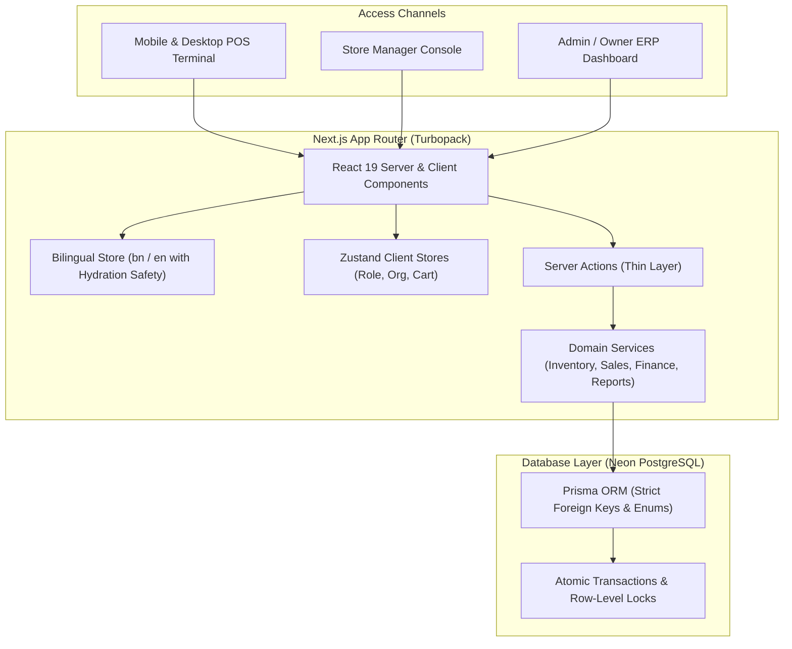
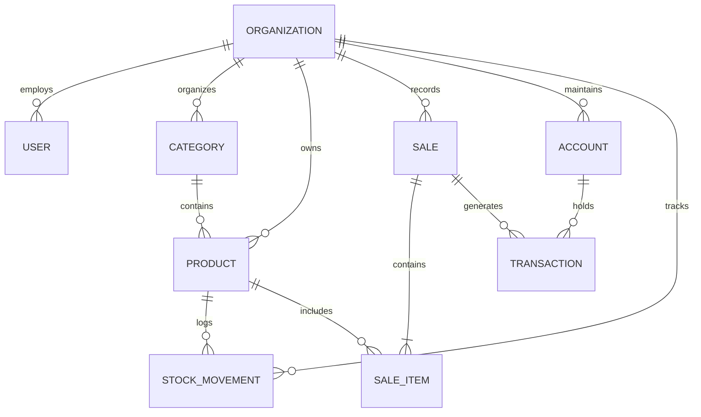
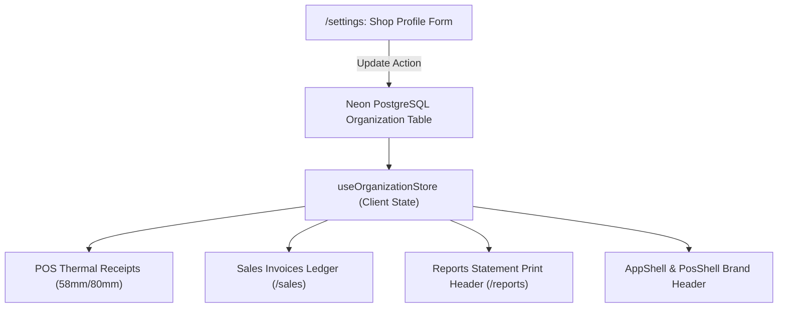
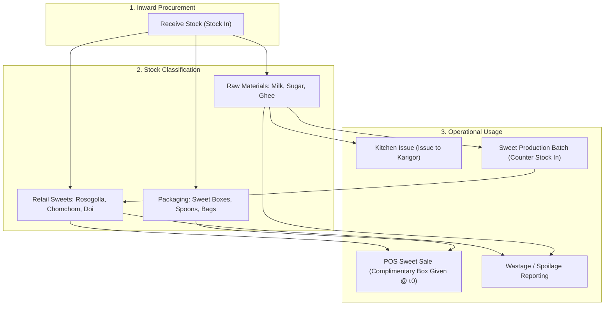

# Sweet Shop Retail Core & ERP — Comprehensive System Documentation

**System Version:** 2.0 (Sweet Shop Specialized Retail & ERP Core)  
**Date:** November 2026  
**Primary Currency / Timezone:** Bangladeshi Taka (৳ BDT) / `Asia/Dhaka`  
**Primary Default Language:** বাংলা (Bangla) with instantaneous English toggle  

---

## Table of Contents

1. [System Overview & Architecture](#1-system-overview--architecture)
2. [Technology Stack](#2-technology-stack)
3. [Project Directory Structure](#3-project-directory-structure)
4. [Database Architecture & Prisma Schema](#4-database-architecture--prisma-schema)
5. [Role-Based Access Control (RBAC)](#5-role-based-access-control-rbac)
6. [Bilingual Architecture & Hydration Safety](#6-bilingual-architecture--hydration-safety)
7. [Dynamic Shop Profile & System-Wide Propagation](#7-dynamic-shop-profile--system-wide-propagation)
8. [Sweet Shop Inventory & Non-Sellable Items Management](#8-sweet-shop-inventory--non-sellable-items-management)
9. [POS Terminal & Sales-Linked Packaging](#9-pos-terminal--sales-linked-packaging)
10. [Sales Ledger, Receipts & Printing Architecture](#10-sales-ledger-receipts--printing-architecture)
11. [Finance, Cash Drawers & Multi-Account Ledgers](#11-finance-cash-drawers--multi-account-ledgers)
12. [Date & Month Financial Reporting (P&L Accounting)](#12-date--month-financial-reporting-pl-accounting)
13. [Setup, Environment Variables & Deployment](#13-setup-environment-variables--deployment)
14. [Server Actions & Service Reference](#14-server-actions--service-reference)

---

## 1. System Overview & Architecture

Sweet Shop Retail Core is an all-in-one Enterprise Resource Planning (ERP) and Point of Sale (POS) system engineered specifically for traditional sweet shops, confectioneries, and dairy retailers (মিষ্টির দোকান ও দুগ্ধজাত কনফেকশনারি).

The application runs as a **Next.js Modular Monolith** utilizing Server Actions, atomic PostgreSQL transactions, and client-side reactive state synchronization.



### Core Business Axioms
1. **Income Originates from Sales:** All operating revenue is driven by confirmed sales invoices. Each sale atomically decrements retail stock, snapshots weighted-average product costs, auto-deducts complimentary packaging boxes, and posts revenue into designated financial accounts (Cash, bKash, Bank).
2. **Strict Inventory Segregation:** Items are categorized into **`RETAIL`** (sellable sweets & doi), **`RAW_MATERIAL`** (milk, sugar, ghee, flour), and **`PACKAGING`** (sweet boxes, spoons, carrier bags). Only sellable items appear on the POS product catalog.
3. **Complimentary Packaging:** In sweet shops, sweet boxes are given free with sweet items based on weight ($1\text{ kg}$, $0.5\text{ kg}$). The system auto-calculates and decrements box inventory at ৳0.00 to keep packaging stock accurate.
4. **Bangla by Default:** All interfaces, currency symbols (`৳`), dates (Dhaka time), receipts, and invoices default to Bengali (`bn`) with instant bilingual toggle to English (`en`).

---

## 2. Technology Stack

| Component | Technology | Version | Purpose |
| :--- | :--- | :--- | :--- |
| **Framework** | Next.js (App Router) | `16.4.4` | Modern React server components, server actions, and Turbopack compiler |
| **Runtime UI** | React / React DOM | `19.0.0` | React 19 primitives with client transitions (`useTransition`) |
| **Language** | TypeScript | `5.7.3` | End-to-end type safety, discriminated unions, and strict null checks |
| **Database** | Neon Serverless PostgreSQL | `v16+` | Serverless PostgreSQL with connection pooling & direct migration URL |
| **ORM** | Prisma Client | `6.19.3` | Type-safe queries, relational schema migrations, and raw query locks |
| **Styling** | Tailwind CSS | `3.4.17` | Responsive mobile styling, thermal print rules, and tabular numerals |
| **State Management**| Zustand | `5.0.3` | Persistent local state (`localStorage`) for cart, active role, and shop profile |
| **UI Components** | Radix UI Primitives | Latest | Accessible modals, dialogs, and portals |
| **Icons** | Lucide React | `0.475.0` | High-fidelity vector iconography |
| **Validation** | Zod | `3.24.2` | Runtime schema validation for forms and server actions |

---

## 3. Project Directory Structure

```text
shop-management-core/
├── SYSTEM_DOCUMENTATION.md       # Root Master System Documentation
├── non_sellable_inventory_plan.md# Domain Architectural Strategy
└── shop/                         # Next.js Application Root
    ├── prisma/
    │   ├── schema.prisma         # PostgreSQL Schema with Enums & Relations
    │   └── seed.ts               # Database Seeding Script (Sweet Shop Data)
    ├── public/                   # Static Public Assets
    ├── src/
    │   ├── actions/              # Next.js Server Actions
    │   │   ├── dashboard.ts      # Real-time KPI summaries & charts
    │   │   ├── finance.ts        # Accounts & manual expense logging
    │   │   ├── inventory.ts      # Stock In, Kitchen Issue, Production, Spoilage
    │   │   ├── organization.ts   # Shop profile & settings synchronization
    │   │   ├── products.ts       # Products, categories & sellable filters
    │   │   ├── reports.ts        # Date/Month P&L and statement queries
    │   │   ├── sales.ts          # POS checkout, payments & sale voids
    │   │   └── users.ts          # Role-based staff user management
    │   ├── app/                  # Next.js App Router Pages
    │   │   ├── (admin)/          # Admin & Store Manager Portal Layout
    │   │   │   ├── dashboard/    # Real-time metrics & KPI summary cards
    │   │   │   ├── finance/      # Accounts balance ledger & expense logging
    │   │   │   ├── inventory/    # Stock levels, Kitchen Issue, Production
    │   │   │   ├── products/     # Catalog, categories, SKU management
    │   │   │   ├── reports/      # Period statements & sweet profitability
    │   │   │   ├── sales/        # Sales invoice ledger & invoice reprint
    │   │   │   └── settings/     # Shop profile, trade license, staff roles
    │   │   ├── (pos)/            # Cashier Dedicated POS Layout
    │   │   │   └── pos/          # Full-screen Touch POS Terminal
    │   │   ├── globals.css       # Tailwind CSS & Print Media Rules
    │   │   └── layout.tsx        # Root HTML Layout & Font Setup
    │   ├── components/           # Reusable Client & Server Components
    │   │   ├── dashboard/        # Trend charts & KPI cards
    │   │   ├── finance/          # Cash drawer modals & expense tables
    │   │   ├── inventory/        # Kitchen issue, sweet batch & wastage modals
    │   │   ├── pos/              # POS Terminal, Receipt Modal, Box Selector
    │   │   ├── products/         # Product table, Category modal, SKU form
    │   │   ├── reports/          # Statement print view & CSV exporters
    │   │   ├── sales/            # Invoice dialog & payment collection
    │   │   ├── settings/         # Shop profile & User manager sections
    │   │   └── shared/           # AppShell, PosShell, LanguageToggle, Pagination
    │   ├── lib/                  # Utilities & Database Singletons
    │   │   ├── i18n.ts           # Bangla & English Typed Dictionaries
    │   │   ├── prisma.ts         # Prisma Client Singleton with Decimal math
    │   │   └── utils.ts          # Tailwind class merger (cn)
    │   ├── modules/              # Core Domain Business Services
    │   │   ├── inventory/        # applyMovement, receiveStock, adjustStock
    │   │   └── sales/            # createSale, recordPayment, voidSale
    │   └── stores/               # Zustand Reactive Stores
    │       ├── cart.ts           # POS cart, calculations, change Tendered
    │       ├── language.ts       # Hydration-safe language store (bn/en)
    │       ├── organization.ts   # Hydration-safe shop profile store
    │       └── role.ts           # Hydration-safe role & access control store
    ├── package.json              # Project Dependencies & Scripts
    ├── tailwind.config.ts        # Tailwind Config & Color Palette
    └── tsconfig.json             # TypeScript Compiler Configuration
```

---

## 4. Database Architecture & Prisma Schema

The relational schema is configured in [`prisma/schema.prisma`](file:///home/orion/Documents/Projects/shop-management-core/shop/prisma/schema.prisma) with explicit constraints, foreign key indexes, and enum types.

### Key Database Models

```prisma
enum Role {
  ADMIN
  OWNER
  MANAGER
  CASHIER
  STAFF
}

enum ProductType {
  RETAIL        // Retail sellable sweets & doi (Displayed in POS)
  RAW_MATERIAL  // Kitchen ingredients: Milk, Sugar, Ghee (Hidden from POS)
  PACKAGING     // Sweet boxes, pots, spoons, carrier bags (Sales-linked)
}

enum MovementType {
  PURCHASE      // Supplier stock in or finished sweet production
  SALE          // POS checkout deduction
  SALE_VOID     // Restored stock upon invoice cancellation
  ADJUSTMENT    // Kitchen issue, spoilage, or count corrections
}

enum SaleStatus {
  COMPLETED
  VOID
}

enum AccountType {
  CASH          // Cash Drawer
  MOBILE        // bKash, Nagad
  BANK          // Commercial Bank Account
}
```



### Relational Model Definitions
- **`Organization`**: Multi-tenant foundation containing company profile, physical address, contact telephone, trade license / VAT BIN, and thermal receipt footer message.
- **`Product`**: Tracks SKU, barcode, unit (`kg`, `pot`, `liter`, `pcs`, `box`), `productType` (`RETAIL`, `RAW_MATERIAL`, `PACKAGING`), `isSellable` boolean flag, selling price, weighted-average cost (`avgCost`), and reorder alert thresholds.
- **`StockMovement`**: Immutable audit log for every change in inventory. Tracks quantity delta, unit cost snapshot, balance after, reference type (`sale`, `purchase`, `production`, `kitchen_issue`), and operator note.
- **`Sale` & `SaleItem`**: Stores invoice numbers (`INV-000001`), customer names, subtotal, discount, total, paid, idempotency keys, and item snapshot costs.
- **`Account` & `Transaction`**: Double-entry financial records representing physical cash drawers, mobile wallets (bKash/Nagad), and bank accounts.

---

## 5. Role-Based Access Control (RBAC)

The application enforces a 3-tier permission hierarchy to prevent unauthorized staff operations.

| Feature / Route | Admin / Owner (`ADMIN`) | Store Manager (`MANAGER`) | POS Cashier (`CASHIER`) |
| :--- | :---: | :---: | :---: |
| **POS Terminal (`/pos`)** | Full Access | Full Access | **Strictly Allowed** |
| **Products Management (`/products`)** | Full Access | Full Access | *Blocked* |
| **Inventory & Kitchen Requisitions (`/inventory`)** | Full Access | Full Access | *Blocked* |
| **Sales Ledger & Voiding (`/sales`)** | Full Access | *Blocked* | *Blocked* |
| **Finance & Cash Accounts (`/finance`)** | Full Access | *Blocked* | *Blocked* |
| **Reports & Profit/Loss (`/reports`)** | Full Access | *Blocked* | *Blocked* |
| **Shop Settings & Staff Roles (`/settings`)**| Full Access | *Blocked* | *Blocked* |
| **Dashboard Executive Metrics (`/dashboard`)**| Full Access | *Blocked* | *Blocked* |

### Route Guard Enforcement
- **Navigation Filtering:** The navigation sidebar ([`AppShell.tsx`](file:///home/orion/Documents/Projects/shop-management-core/shop/src/components/shared/AppShell.tsx)) dynamically filters links according to the logged-in user's role.
- **Route Interception:** Any cashier attempting to access `/dashboard`, `/sales`, `/finance`, or `/settings` is caught by a client route guard displaying an **"Access Restricted (অননুমোদিত প্রবেশাধিকার)"** banner and an automatic redirect button to `/pos`.
- **POS Cashier Containment:** In [`PosShell.tsx`](file:///home/orion/Documents/Projects/shop-management-core/shop/src/components/shared/PosShell.tsx), the "Back to Dashboard" button is automatically hidden for Cashiers.

---

## 6. Bilingual Architecture & Hydration Safety

The system features complete internationalization (i18n) designed to run primarily in Bengali (`bn`) with instant English (`en`) support.

### Translation Architecture ([`src/lib/i18n.ts`](file:///home/orion/Documents/Projects/shop-management-core/shop/src/lib/i18n.ts))
Two typed dictionaries implement the `TranslationDictionary` interface:
- **`bnTranslations`**: Complete Bengali translations for sweet shop vocabulary, POS actions, receipt headers, and financial terms.
- **`enTranslations`**: English counterpart translations.

### Hydration Safety Architecture
Next.js SSR can cause hydration mismatches when client components read `localStorage` on initial render. This system prevents mismatches through dedicated hydration-safe hooks:
- **`useHydratedLanguage()`**: Returns the deterministic server default (`"bn"`) during initial hydration, switching smoothly to stored user preferences post-mount without React hydration warnings.
- **`useHydratedRole()`**: Prevents tree mismatches when evaluating role-guarded buttons and links.
- **`useHydratedOrganization()`**: Guarantees synchronous initial matching of shop branding.
- **`suppressHydrationWarning`**: Added to dynamic elements such as the live Dhaka clock and currency badges.

---

## 7. Dynamic Shop Profile & System-Wide Propagation

Store details configured in **Settings $\rightarrow$ Shop Profile** ([`ShopProfileSection.tsx`](file:///home/orion/Documents/Projects/shop-management-core/shop/src/components/settings/ShopProfileSection.tsx)) instantly propagate across all operational surfaces without requiring full page reloads.



### Propagated Attributes
1. **Shop Name (দোকানের নাম):** e.g., `মৌচাক সুইটস অ্যান্ড কনফেকশনারি`
2. **Physical Address (দোকানের পূর্ণ ঠিকানা):** e.g., `১২/এ সাতমসজিদ রোড, ধানমন্ডি, ঢাকা-১২০৯`
3. **Contact Phone (মোবাইল নম্বর):** e.g., `০১৭১১-২৩৪৫৬৭ (+880 1711-234567)`
4. **Trade License / VAT BIN (ট্রেড লাইসেন্স / ভ্যাট রেজি: BIN):** e.g., `BIN-০০২৯৩৮৪৭১-০১০১`
5. **Receipt Footer Message (রশিদ বার্তার সমাপ্তি):** e.g., `স্বাদে ও ঐতিহ্যে অনন্য • মিষ্টির মিষ্টি মুখ • সাথে থাকার জন্য ধন্যবাদ!`

---

## 8. Sweet Shop Inventory & Non-Sellable Items Management

Sweet shop inventory is divided into three distinct operational flows:



### A. Raw Materials (দুধ, চিনি, ঘি, ময়দা)
Raw materials cannot be sold at the cash register. They are converted in the kitchen workshop:
1. **Kitchen Requisition / Issue ([`issueKitchenStockAction`](file:///home/orion/Documents/Projects/shop-management-core/shop/src/actions/inventory.ts)):** Store manager logs ingredients handed over to the master sweet maker (Karigor). Decrements raw stock with `[Kitchen Issue]` notes.
2. **Sweet Production Batch ([`recordSweetProductionAction`](file:///home/orion/Documents/Projects/shop-management-core/shop/src/actions/inventory.ts)):** When fresh sweets arrive at the counter, the Karigor logs the produced weight (e.g., 15 kg Rosogolla). The system can optionally auto-deduct raw ingredients (e.g., 30L milk, 6kg sugar) and increments finished sweet stock at calculated batch cost.
3. **Spoilage & Wastage ([`reportWastageAction`](file:///home/orion/Documents/Projects/shop-management-core/shop/src/actions/inventory.ts)):** If milk curdles or sweets spoil, managers log the exact loss and reason. Stock is decremented and tracked under wastage.

### B. Sales-Linked Packaging (মিষ্টির বক্স, চামচ, প্যাকেট)
1. **Hidden from POS Product Cards:** Boxes and spoons have `productType: "PACKAGING"` and `isSellable: false`, keeping the retail POS catalog uncluttered.
2. **Auto-Calculated Complimentary Allocation:** Adding sweets to the cart automatically suggests matching sweet boxes ($1\text{ kg}$, $0.5\text{ kg}$) based on sweet weight.
3. **Zero Billing with Live Stock Tracking:** The customer is charged **৳০.০০** for the box. Upon checkout, the sweet box inventory count is atomically decremented.

---

## 9. POS Terminal & Sales-Linked Packaging

The POS terminal ([`PosTerminal.tsx`](file:///home/orion/Documents/Projects/shop-management-core/shop/src/components/pos/PosTerminal.tsx)) is optimized for rapid touch counters and mobile checkout.

### Key Terminal Capabilities
- **Mobile Responsive Layout:** Seamless switching between **Catalog Tab** and **Order Tab** on small mobile displays, with floating cart counter bars.
- **Fast Product Search & Barcode Scanning:** Instant search with barcode reader support (`F2` shortcut).
- **Complimentary Box Selector:** Displays available sweet boxes with live stock badges and `+`/`−` controls. Includes an **"স্বয়ংক্রিয় হিসাব" (Auto Calculate)** button that analyzes cart weight in real time.
- **Multi-Payment Tender:** Supports Cash, bKash, and Bank payments. Automatically computes change given or credit due.
- **Keyboard Shortcuts:** `F2` focuses search; `F9` triggers checkout.

---

## 10. Sales Ledger, Receipts & Printing Architecture

### A. Sales Invoices Ledger ([`/sales`](file:///home/orion/Documents/Projects/shop-management-core/shop/src/app/(admin)/sales/page.tsx))
- Displays invoice history, customer name, total, amount paid, and outstanding balance due.
- Status badges: Fully Paid (Green), Due Balance (Amber), Voided (Rose).
- **Payment Collection Modal:** Allows collecting subsequent installment payments on credit sales, updating balances in real time.
- **Atomic Voiding:** Voiding a sale restores all items (sweets and boxes) back to inventory and reverses linked income transactions.

### B. Print Media Engine ([`globals.css`](file:///home/orion/Documents/Projects/shop-management-core/shop/src/app/globals.css))
The application features specialized CSS print media queries ensuring clean output without UI clutter:
- **`#thermal-receipt`**: Formatted for standard 58mm and 80mm ESC/POS roll receipt printers.
- **`#invoice-printable`**: Formatted for A4 / Letter full customer invoices.
- **`#statement-printable`**: Formatted for executive P&L financial reports.

```css
@media print {
  body * {
    visibility: hidden;
  }
  #thermal-receipt, #thermal-receipt *,
  #invoice-printable, #invoice-printable *,
  #statement-printable, #statement-printable * {
    visibility: visible;
  }
  #thermal-receipt, #invoice-printable, #statement-printable {
    position: absolute;
    left: 0;
    top: 0;
    width: 100%;
    margin: 0;
    padding: 0;
  }
}
```

---

## 11. Finance, Cash Drawers & Multi-Account Ledgers

The finance module ([`/finance`](file:///home/orion/Documents/Projects/shop-management-core/shop/src/app/(admin)/finance/page.tsx)) operates on multi-account balances:

1. **Cash Drawer (ক্যাশ কাউন্টার):** Tracks physical cash tendered at the POS.
2. **bKash / Mobile Wallet (বিকাশ / নগদ মার্চেন্ট):** Tracks digital QR / USSD customer payments.
3. **Bank Account (ব্যাংক হিসাব):** Tracks direct card/bank transfers and supplier purchase disbursements.

### Transaction Sources
- **`SALE`**: System-generated income from POS sales.
- **`PURCHASE`**: System-generated disbursements for inventory purchases.
- **`MANUAL`**: Manual operating income (e.g. supplier rebate) and overhead expenses (rent, electricity, gas, staff salaries).

---

## 12. Date & Month Financial Reporting (P&L Accounting)

The reports engine ([`DateMonthReportsView.tsx`](file:///home/orion/Documents/Projects/shop-management-core/shop/src/components/reports/DateMonthReportsView.tsx)) provides real-time Profit and Loss statements adjusted to Dhaka local time (`Asia/Dhaka`).

### Report Presets & Filters
- **Today (আজ):** Strict 24-hour statement from 00:00:00 to 23:59:59.
- **Yesterday (গতকাল):** Previous day reconciliation.
- **This Month (চলতি মাস):** Default calendar month view.
- **Last Month (গত মাস):** Complete prior month financial summary.
- **Month Picker (মাস নির্বাচন):** Pick any past month and year.
- **Custom Range (কাস্টম তারিখ):** Specify exact start and end dates.

### Financial Formulas
$$\text{Net Revenue} = \text{Gross Sales} - \text{Discounts}$$
$$\text{Gross Profit} = \text{Net Revenue} - \text{COGS (Sweets + Packaging)}$$
$$\text{Gross Margin} = \frac{\text{Gross Profit}}{\text{Net Revenue}} \times 100$$
$$\text{Net Operating Profit} = \text{Gross Profit} - \text{Operating Expenses (Raw Materials + Overhead)}$$
$$\text{Net Margin} = \frac{\text{Net Profit}}{\text{Net Revenue}} \times 100$$

### CSV Data Exports
Managers can export high-fidelity CSV files for external audits:
1. **P&L Statement CSV (`sweet-shop-pl-statement.csv`)**
2. **Sweet Items Profitability CSV (`sweet-items-sales-report.csv`)**
3. **Raw Materials & Box Purchases CSV (`raw-materials-and-boxes-purchases.csv`)**

---

## 13. Setup, Environment Variables & Deployment

### Local Development Setup

#### 1. Clone & Install Dependencies
```bash
cd shop
npm install
```

#### 2. Configure Environment Variables
Create a `.env` file in the `shop` directory:
```env
# Neon PostgreSQL Connection URLs
DATABASE_URL="postgresql://[user]:[password]@[neon-host]/[dbname]?sslmode=require&pgbouncer=true&connect_timeout=15"
DIRECT_URL="postgresql://[user]:[password]@[neon-host]/[dbname]?sslmode=require&connect_timeout=15"

# Environment
NODE_ENV="development"
NEXT_TELEMETRY_DISABLED=1
```

#### 3. Database Generation & Seed
```bash
# Generate Prisma Client
npx prisma generate

# Apply Schema to Neon PostgreSQL
npx prisma db push

# Seed Sweet Shop Initial Organization, Accounts, Categories & Sweets
npx tsx prisma/seed.ts
```

#### 4. Run Development Server
```bash
npm run dev
# Open http://localhost:3000 in your browser
```

#### 5. Verify Typecheck & Production Build
```bash
npm run typecheck
npm run build
```

---

## 14. Server Actions & Service Reference

| Server Action | File Location | Description |
| :--- | :--- | :--- |
| `createSaleAction` | `src/actions/sales.ts` | Atomically completes sale, allocates packaging boxes, deducts stock, posts income |
| `voidSaleAction` | `src/actions/sales.ts` | Reverses sale, restores inventory stock, voids linked revenue |
| `recordSalePaymentAction` | `src/actions/sales.ts` | Records installment payment on credit sale |
| `issueKitchenStockAction` | `src/actions/inventory.ts` | Issues raw materials (milk, sugar, ghee) to sweet kitchen workshop |
| `recordSweetProductionAction` | `src/actions/inventory.ts` | Stocks finished sweets into counter; auto-deducts recipe ingredients |
| `reportWastageAction` | `src/actions/inventory.ts` | Deducts spoiled/damaged raw material or sweet from inventory |
| `receiveStockAction` | `src/actions/inventory.ts` | Records supplier purchase and updates weighted-average cost |
| `getProducts` | `src/actions/products.ts` | Fetches products with optional `{ sellableOnly: true }` filter |
| `getPackagingBoxes` | `src/actions/products.ts` | Returns active sweet packaging boxes for POS checkout |
| `getOrganizationAction` | `src/actions/organization.ts` | Retrieves live organization profile for invoices and receipts |
| `updateOrganizationAction` | `src/actions/organization.ts` | Updates shop name, address, BIN, footer note, and revalidates paths |
| `getDateRangeReportAction` | `src/actions/reports.ts` | Computes revenue, COGS, profit margins, and purchase ledgers |
